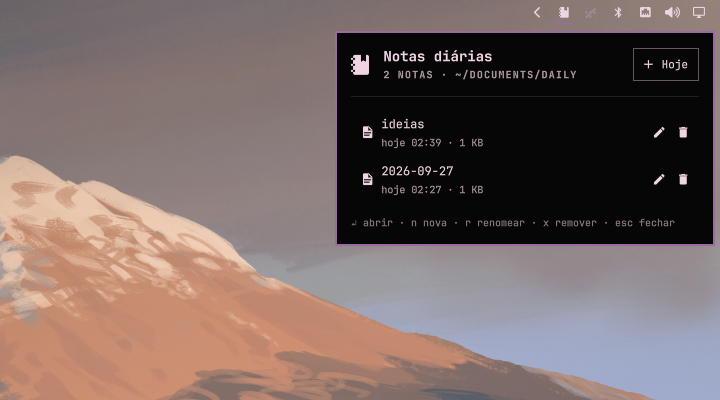

# Daily Notes for Omarchy

A bar widget for the [Omarchy](https://omarchy.org) shell that keeps a list of
daily markdown notes. One click creates today's note (`YYYY-MM-DD.md`) and opens
it in a floating Neovim window; the panel lets you open, rename and remove
notes without leaving the bar.



## Features

- **Today** button (or right-click the bar icon) creates `YYYY-MM-DD.md` and
  opens it right away. If today's note already exists, `-2`, `-3`, … is appended.
- Each row opens the note in a floating Neovim; inline **rename** and
  two-step **remove** (moved to the trash when `gio` is available).
- Keyboard driven: `j`/`k` move, `Enter` open, `n` new, `r` rename, `x` remove,
  `Esc` close, `Tab` switch to the neighbouring panel.
- Notes live in a plain folder (`~/Documents/daily` by default) — nothing is
  locked into the plugin.
- The editor runs with its own Neovim profile (`NVIM_APPNAME=nvim-daily`), so
  your main Neovim setup is untouched. A minimal starter config is bootstrapped
  on first use **only if** `~/.config/nvim-daily` does not exist yet.

## Requirements

- Omarchy Quattro (Quickshell-based `omarchy-shell`)
- `neovim`
- `xdg-terminal-exec` and `uwsm` (both ship with Omarchy; the default terminal
  is used)
- Optional: `gio` (GLib) to send removed notes to the trash instead of `rm`

No `sudo` or `pkexec` is required.

## Install

```bash
omarchy plugin add https://github.com/AndreMaciel66/omarchy-daily-notes.git --enable
```

Or manually:

```bash
git clone https://github.com/AndreMaciel66/omarchy-daily-notes.git \
  ~/.config/omarchy/plugins/thecraftlab.daily-notes
omarchy plugin enable thecraftlab.daily-notes right
```

The editor window uses the `TUI.float` app-id by default, which Omarchy already
floats and centers — no Hyprland changes are needed.

### Optional: custom window size

Give the editor its own app-id in `~/.config/omarchy/shell.json` …

```json
{ "id": "thecraftlab.daily-notes", "appId": "thecraftlab.daily-notes" }
```

… and add window rules in `~/.config/hypr/hyprland.lua`:

```lua
o.window("thecraftlab.daily-notes", { float = true })
o.window("thecraftlab.daily-notes", { center = true })
o.window("thecraftlab.daily-notes", { size = { 1000, 700 } })
```

## Settings

Set these on the widget entry in `~/.config/omarchy/shell.json`:

| key           | default              | description                                              |
|---------------|----------------------|----------------------------------------------------------|
| `notesDir`    | `~/Documents/daily`  | Folder holding the `.md` notes (created if missing).      |
| `appId`       | `TUI.float`          | App-id of the editor window.                              |
| `nvimAppName` | `nvim-daily`         | `NVIM_APPNAME` for the editor; `nvim` uses your default.  |

## IPC

```bash
omarchy-shell thecraftlab.daily-notes toggle    # open/close the panel
omarchy-shell thecraftlab.daily-notes newNote   # create and open today's note
```

Handy as a keybinding in `~/.config/hypr/bindings.lua`:

```lua
o.bind("SUPER + SHIFT + N", "Today's note", "omarchy-shell thecraftlab.daily-notes newNote")
```

## Remove

```bash
omarchy plugin remove thecraftlab.daily-notes
```

Your notes stay in `notesDir`. If you want the starter Neovim profile gone as
well, delete `~/.config/nvim-daily`, and remove any window rules you added.

## Files

- `manifest.json` — plugin manifest
- `Panel.qml` — bar button and panel UI
- `daily-notes.sh` — list/new/open/rename/delete backend
- `nvim/init.lua` — starter Neovim profile copied to `~/.config/nvim-daily` on first use

## License

[MIT](LICENSE)
